<p align="center"></p>

# OpenNotch Music

**Un reproductor open source para el notch de tu Mac.**

Controla Spotify desde una interfaz nativa, compacta y animada. Desarrollado con SwiftUI y AppKit, sin dependencias externas. La aplicación aparece como **Notch Music** en macOS.

**Código abierto · Licencia MIT · macOS 14+ · Apple Silicon**

[Descargar v0.4.1](https://github.com/Auky216/open-notch-music/releases/download/v0.4.1/OpenNotch-Music-0.4.1-macOS-arm64.zip) · [Versiones](https://github.com/Auky216/open-notch-music/releases) · [Reportar un problema](https://github.com/Auky216/open-notch-music/issues)

## Qué incluye

- Carátula e indicador de audio en la vista compacta.
- Título, artista, álbum, progreso y controles en la vista expandida.
- Reproducción, pausa, anterior, siguiente, volumen, aleatorio y repetición.
- Transición continua con resorte y apertura al acercar el cursor, incluida la zona de la cámara.
- Respuesta háptica opcional en trackpads compatibles.
- Panel sobre otras apps, con soporte comprobado en pantalla completa de Brave.
- Controles debajo de la barra de menús para evitar solapamientos con sus iconos.
- Visualizador opcional que responde al audio real de Spotify.
- Selección de pantalla, visibilidad, apertura con cursor e inicio con la sesión.
- Compatibilidad con Reducir movimiento y controles con etiquetas de accesibilidad.
- Icono propio minimalista; [fuente vectorial y notas de diseño](Resources/Icon/DESIGN.md).

Spotify sigue reproduciendo el audio. OpenNotch Music muestra su estado y envía los controles a la app de escritorio. No necesitas una cuenta de desarrollador de Spotify ni configurar claves de su API web.

## Descargar e instalar

1. Descarga el ZIP desde [Releases](https://github.com/Auky216/open-notch-music/releases).
2. Descomprímelo y mueve **Notch Music.app** a Aplicaciones.
3. Abre Spotify y reproduce una canción.
4. Abre Notch Music, acerca el cursor al notch y pulsa **Conectar**. macOS puede solicitar permiso de Automatización para controlar Spotify.
5. Opcionalmente, pulsa **Activar ritmo real** para usar el visualizador de audio.

La versión descargable es una **compilación preliminar para Apple Silicon**, con firma local ad hoc. Todavía no cuenta con firma Developer ID ni notarización de Apple; macOS puede bloquear su apertura. También puedes compilarla desde el código fuente. La versión no se ha validado en Intel.

El icono de la barra de menús permite abrir el reproductor, conectar Spotify, mostrar u ocultar el panel, abrir ajustes y salir. El atajo propuesto es **Control + Opción + Espacio**, sujeto a que otra app o el sistema no lo tenga registrado.

Si tienes otra app que usa el notch, ciérrala durante el uso para evitar paneles superpuestos.

## Audio y privacidad

El visualizador requiere **macOS 14.2 o posterior** y permiso de audio del sistema. Analiza cuatro bandas de frecuencia mediante un tap limitado a los procesos de Spotify.

- El análisis se realiza localmente.
- No usa el micrófono ni captura la pantalla.
- No guarda ni envía el audio.
- Sin señal o sin permiso las barras permanecen quietas.
- Responde a la energía del audio; no calcula BPM.

El audio se toma de Spotify de escritorio en este Mac. Spotify web y la reproducción remota mediante Spotify Connect no están validados. Las carátulas se descargan de la URL proporcionada por Spotify. No hay servidor propio ni analíticas.

## Compilar

Requisitos: macOS 14 o posterior y Xcode con las herramientas de Swift y el SDK de macOS.

```sh
git clone https://github.com/Auky216/open-notch-music.git
cd open-notch-music
./scripts/build.sh
```

La app se genera en `dist/Notch Music.app`. El script compila en modo release, copia los recursos y firma localmente el paquete con el permiso de Apple Events. El icono ya está incluido; no se generan imágenes durante la ejecución de la app.

## Pruebas

```sh
swift test --disable-sandbox --build-system native
```

La suite comprueba progreso, valores inválidos de controles, tiempos, continuidad del resorte y respuesta del analizador a frecuencias y silencio.

Para probar el panel real con datos de demostración, cierra primero la instancia normal:

```sh
"dist/Notch Music.app/Contents/MacOS/NotchMusic" --verify-animations "$PWD/dist/qa"
swift scripts/check-frames.swift "$PWD/dist/qa"
```

La prueba exporta fotogramas e informes de apertura, cierre, inversión, movimiento reducido y comportamiento del cursor. Comprueba además la transparencia fuera de la silueta. La sensación háptica requiere una prueba humana con un trackpad compatible.

Vista previa con datos ficticios:

```sh
"dist/Notch Music.app/Contents/MacOS/NotchMusic" --render-preview "$PWD/dist/preview.png"
```

## Rendimiento

- El análisis de audio se detiene en pausa, al ocultar el panel y al apagar la pantalla.
- La vista expandida se desmonta al cerrar.
- Los eventos de Spotify disparan actualizaciones; las consultas de respaldo se espacian según el estado: 2 segundos abierto/reproduciendo, 4 compacto/reproduciendo, 8 en pausa y 12 sin pista.
- Las carátulas se reducen a 320 píxeles y su caché admite 12 imágenes, con un límite de coste de 8 MiB.
- La animación ejecuta su temporizador solo durante las transiciones y se adapta a la frecuencia de la pantalla.
- El respaldo de detección del cursor trabaja con menor frecuencia lejos del notch.

Las mediciones puntuales no garantizan el mismo consumo en todos los equipos. El consumo aumenta al animar y analizar audio. Los diagnósticos opcionales se escriben únicamente si se inicia la app con sus argumentos de prueba.

## Estado del proyecto

Primera versión pública: **0.4.1**, en desarrollo. Ver [CHANGELOG.md](CHANGELOG.md).

Probada localmente en Apple Silicon con macOS 26.6.2 y Spotify 1.3.6.1921. Quedan por validar Intel, otros equipos y versiones, monitores externos, reposo prolongado, otros escenarios de Spaces y cuentas de Spotify diferentes. Apple Music, archivos, AirDrop, Pomodoro, portapapeles, calendario, búsqueda y letras son posibles mejoras futuras.

Se aceptan issues y pull requests. Consulta [CONTRIBUTING.md](CONTRIBUTING.md).

## Licencia

Código y diseño propio disponibles bajo la [licencia MIT](LICENSE). Proyecto independiente, sin afiliación con Apple ni Spotify; sus marcas pertenecen a sus respectivos propietarios.
